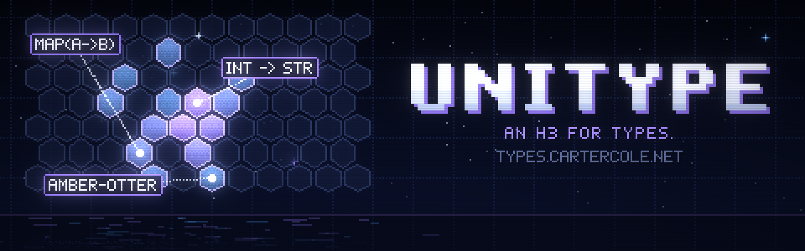

# unitype

[types.cartercole.net](https://types.cartercole.net) · [the specification](protocol/PROTOCOL.md)

**An H3 for types.** H3 gives every hexagon on Earth a canonical ID that anyone
can compute without asking anyone; `interval_clock` does it for every periodic
interval in time. This project does it for types: every type gets a canonical
form, a content address computed from its structure alone, and three ordinary
words you can say out loud — so two systems that have never exchanged a schema
can find out they hold the same type by comparing 32 bytes, and two people can
find out by comparing a phrase.

On top of that naming layer sits the part that makes it useful: a function
signature is a **proposition**, and an implementation of it is a **proof**.
There can be many proofs of one proposition, in any mix of compiled and
interpreted languages, with different time and memory costs — and picking among
them at call time is a policy decision, not an architectural one.

```
  proposition          demo::sort : (xs: List<i64>) -> List<i64>
                       │
  proofs        ┌──────┼───────────────┬──────────────────┐
                │      │               │                  │
           mergesort  bubble sort   sort.wasm        an Expr body
           (Rust,     (Python,      (portable,       (symbolic, transpiles
            native)    subprocess)   sandboxed)       to every language)
           O(n log n) O(n²)         O(n log n)       O(?)
           space O(n) space O(1)    space O(n)
```

Ask for the fastest one and you get the Rust mergesort. Ask for the smallest
memory footprint and you get the Python bubble sort, over a pipe, and the same
answer. Both are checked against the proposition at the boundary, so a proof
that lies about what it proves is caught rather than trusted.

## The idea in one paragraph

Everything is a literal. Types, declarations, values, and function bodies all
serialize to plain JSON, so the representation *is* the wire format *is* the
authoring format — an object in one language goes in, and comes back out as an
object in another. Normalization gives each semantic type exactly one
serialization (unions flatten and sort, `T??` collapses to `T?`, optionality
hoists out of unions), and a blake3 hash over those bytes is the type's
identity, excluding names, prose, and annotations because none of those are what
makes a type what it is. Types live in **universes** — named worlds, one per
system or schema version — where inheritance is nominal and checked; between
universes nothing is compatible by accident, and data crosses only through an
explicit **link** that says how, witnessed by a mapping anyone can read.

## Status

The loop closes. A type can be described, checked, addressed, named, bridged to
another universe, generated as code, and computed — in more than one language —
today.

**Built**

- **The symbolic core.** Types, values, canonical form, content addressing, word
  aliases.
- **The checker.** Inheritance, subtyping, refinement, generic bounds,
  variance inferred from where each parameter occurs, and structural
  addressing that erases names across a whole workspace — by key, by
  position, and as a bag of types in any order under any names.
- **Bounds.** `i32[0..255]`, `[octet; 4]`, `bytes[16]`, `str[len 1..63,
  size ..253]`: a type with bounds on an integer's value, or on a length — in
  items, in bytes, or for a string, which every language counts differently,
  in both. The checker refuses `[256, 1, 1, 1]` as an IPv4 address with no
  parser involved; the wire form is the plain value; Rust spells them `u8`,
  `u16`, and `[u8; 4]`.
- **Restrictions.** A string can be restricted to the strings a regular
  expression matches in full, `str[match "[a-z]+"]`, and a future to a window in
  which its value must arrive, `future<T>[wait 100..5000]`. Both are checked
  where a value crosses a boundary, the way a bound is, not by the checker. A
  proof that misses its window is passed over for one that meets it. A
  restriction class is a signature with no proof that others refine: a
  signature that promises a window follows a class that asks for one.
- **Bridges.** Derived from two declarations, composed along a path, and run
  through the same expression language a person writes a proof in. An
  equivalence — the same data renamed and reordered — loses nothing, so one
  link runs both ways.
- **The expression language.** Total by construction, and now able to say
  something: a `fold` carries a value through a list, `case` and `match` take
  an optional and an enum apart, and a closed set of operations compares,
  adds, and counts. `demo::sorted` checks that a list is in order in all four
  target languages without anyone implementing it.
- **Reading.** Text becomes a value *against* a type, which is what lets an
  object become a map and `"Red"` become a variant.
- **The runtime.** Environments register what they can prove; a policy decides
  which proof answers a call; a worker keeps an interpreter alive between calls.
  A proof of `request(url, cb)` answers `request(callback, getUrl)` once the two
  are declared equivalent, handed the arguments in its own order.
- **A sandbox.** A proof compiled to WebAssembly gets memory, a budget, and
  nothing else — no files, no sockets, no clock — so a proof you did not write
  has somewhere to run where it can only answer. Behind `--features wasm`,
  because the engine is a large thing to build for a capability not every
  workspace wants.
- **Code generation.** TypeScript, Python, Rust, and Haskell — checked by
  running the generated code in all four and comparing what it produces against
  what unitype says the value is. The Python, Node and Haskell harnesses are
  each reached through the dispatcher as a proof. Generic declarations and
  signatures keep their parameters and bounds in all four; generic Python is
  written in the type parameter syntax of 3.12, and everything else still reads
  on 3.10. A value written against its type takes the shape each language's own
  JSON gives it — a tuple is an array, a map an object, bytes base64 text — so
  what unitype writes, and what a proof is sent, is what the generated code
  reads. Haskell needs nothing but what comes with GHC: its instances are
  written against a small JSON module generated beside the universes, so
  nothing is fetched, and a field is named after the type that holds it
  (`circleRadius`) because a Haskell module has one space for them all.
- **The `unitype` command**, over all of it.
- **Conformance.** The proofs of one proposition checked against each other,
  since `sort` and `reverse` have the same type and only running both tells them
  apart.
- **Free theorems.** A generic proposition is checked from its signature alone.
  A proof of `reverse<T>` cannot look at a `T`, so every `T` it returns must be
  one it was given, and relabelling them must commute with it — which the
  harness checks without a vector file, by passing tokens and then the same
  shape relabelled. A proof that sorts when it sees integers is caught.
- **Reflection.** A built-in universe describes the representation, and is
  checked against it, so it cannot drift.

797 tests, including the subtyping, inference and shape laws as property
tests, and pinned golden vectors that make canonical drift impossible to do by
accident. 808 with the sandbox turned on.

```bash
cargo test
cargo test --features unitype-runtime/wasm,unitype-cli/wasm
```

## Try it

```bash
cargo run -p unitype-cli -- --project examples/demo check
cargo run -p unitype-cli -- --project examples/demo ls types
```

The last of those prints three words beside every type. `geo::Point` and
`gfx::Vec2` get the *same* three, because they hold the same data — which
nobody told it.

```bash
# One proposition, two proofs, in two languages. Same answer either way.
cargo run -p unitype-cli -- --project examples/demo \
    run demo::sort --args '[[5,3,9,1]]' --policy fastest -v
cargo run -p unitype-cli -- --project examples/demo \
    run demo::sort --args '[[5,3,9,1]]' --policy min-memory -v

# A generic proposition is a claim about every type, and a call is made at one.
cargo run -p unitype-cli -- --project examples/demo \
    run demo::reverse --args '[["a","b","c"]]' --at '["str"]' -v

# The same proposition again, proved somewhere it can reach nothing at all.
cargo build --release --target wasm32-unknown-unknown \
    --manifest-path examples/wasm-guest/Cargo.toml
cargo run -p unitype-cli --features wasm -- --project examples/demo \
    run demo::sort --args '[[5,3,9,1]]' --impl sort.sandboxed -v

# A value crossing between universes, through a conversion nobody wrote out.
cargo run -p unitype-cli -- --project examples/demo bridge \
    --from geo::Place --to gfx::Marker \
    --data '{"placeId":"p-1","displayName":"The Angel","at":{"lat":51.53,"lon":-0.1}}'

# The same value, written the way each language would have written it.
cargo run -p unitype-cli -- --project examples/demo cast --lang rust \
    --type demo::Circle --data '{"id":"c-1","kind":"circle","radius":2.5}'
cargo run -p unitype-cli -- --project examples/demo cast --lang haskell \
    --type demo::Circle --data '{"id":"c-1","kind":"circle","radius":2.5}'

# Do the two proofs of sort actually agree? And do the two proofs of
# reverse<T> — one Rust, one Python — obey the theorem their signature
# states, with nobody having written down a single expected answer?
# (Exit code 4 if not.)
cargo run -p unitype-cli -- --project examples/demo conform

# A declaration, shown as the value it is — and checked against the type
# that describes declarations.
cargo run -p unitype-cli -- --project examples/demo reflect geo::Point
```

One call, and what every platform decided to call it:

```bash
cargo run -p unitype-cli -- --project examples/http words http::request
```

```
http::request(req: http::Request) -> future<http::Response>

  address   ut1:cd212e2df458227e6cc86b268247421129122977094fe54b560f7a24a0d3a9f6
  words     essay-border-siren

  Called:
    python      requests.request          in python
    rust        reqwest::Client::execute  in rust
    sh          curl                      in shell
    typescript  fetch                     in browser
    typescript  fetch                     in node
```

`curl` is a program, `fetch` is a global, `requests` is a package you install —
three different kinds of thing, which is why an environment and a language are
separate here. Underneath they answer the same proposition, and `essay-border-siren`
is what that proposition is called when you have to say it to a person.

That example only names its proofs. `examples/fetch` runs them: one smaller
proposition, `fetch_text(url: str) -> future<str>`, proved with `urllib` in
Python, `fetch` in Node, and `ureq` in Rust, and held to one answer against a
local server.

```bash
cargo run -p unitype-cli -- --project examples/fetch gen        # the harnesses the proofs import
cargo build --release --manifest-path examples/fetch/rust/Cargo.toml
python3 examples/fetch/serve.py &                                # pages on 127.0.0.1:8765
cargo run -p unitype-cli -- --project examples/fetch conform
```

```
fetch::fetch_text  3 proofs, 6 cases  — all agree
```

The case that earns its place is a page sent as Latin-1. Its bytes only read as
`café` if the declared charset is honoured, and the shortest way to fetch text
in Node — `response.text()` — does not honour it. A proof written that way
returns `caf�`, and `conform` says so and exits 4.

`examples/net` says what an address *is* before saying what it looks like.
`net::IpV4` is `[octet; 4]`, an `octet` being `i32[0..255]`, so the checker
refuses `[256, 1, 1, 1]` with no parser involved, and generated Rust spells it
`[u8; 4]`. The text is two propositions, `parse_v4(text: str) -> IpV4?` and
`format_v4(ip: IpV4) -> str`, and two more for IPv6, each proved with Python's
`ipaddress`, with Rust's `std::net`, and in Node, which has no parser and so
gets one written for it. Sixty-six cases hold the three to one answer, and the
propositions say the things platforms decide differently: a leading zero is
refused, a zone is not part of an address, an IPv4-mapped address is written
with dots. `ls types` gives `net::hextet` and `net::port` the same three words,
since both are `i32[0..65535]` and nobody had to say so.

```bash
cargo run -p unitype-cli -- --project examples/net gen
cargo build --release --manifest-path examples/net/rust/Cargo.toml
cargo run -p unitype-cli -- --project examples/net conform
```

```
net::format_v4  3 proofs, 4 cases  — all agree
net::format_v6  3 proofs, 12 cases  — all agree
net::parse_v4  3 proofs, 20 cases  — all agree
net::parse_v6  3 proofs, 30 cases  — all agree
```

A proof can be written in Haskell too, and nothing needs installing beyond GHC.
`gen` writes a module for each universe and, beside them, the two every proof
shares: `UnitypeSupport.hs`, which reads and writes the wire form, and
`UnitypeHarness.hs`, which answers a request. A proof is an ordinary function of
any number of arguments over the generated types — in `IO` if it has to wait —
and `proves` is all it takes to be reachable:

```haskell
import Data.Int (Int64)
import Data.List (sort)
import UnitypeHarness (proves, unitypeMain)

main :: IO ()
main = unitypeMain [("sort", proves (sort :: [Int64] -> [Int64]))]
```

```bash
cargo run -p unitype-cli -- --project examples/demo gen --lang haskell
cd examples/demo && ghc -O -igenerated/haskell -outputdir obj -o proofs Proofs.hs
```

Then point an environment at the program, with a path relative to the manifest
(`"reach": {"k": "subprocess", "command": "../proofs"}`), and register it as a
proof of `demo::sort`. It is held to the signature like any other, and `conform`
checks it against the Rust and Python ones. A proof of a generic proposition
takes its elements as `Json`. Nothing in Haskell stops it looking inside one, so
the free theorem is checked rather than assumed.

## What it looks like

A universe is a JSON document. Shorthand keeps it readable; the canonical object
form is what gets hashed.

```json
{
  "name": "demo",
  "types": [
    {"k": "struct", "name": "Shape", "fields": [{"name": "id", "ty": "str"}]},
    {"k": "struct", "name": "Circle", "extends": "Shape",
     "fields": [{"name": "kind", "ty": {"k": "literal", "value": {"str": "circle"}}},
                {"name": "radius", "ty": "float"}]}
  ],
  "functions": [
    {"name": "sort", "params": [{"name": "xs", "ty": "[int]"}], "ret": "[int]"},
    {"name": "load", "params": [{"name": "id", "ty": "str"}], "ret": {"k": "future", "of": "Shape?"}}
  ]
}
```

Content addressing falls out of the structure, not the name:

```rust
use unitype_core::canon::{full_alias, local_hash};
use unitype_core::ir::Type;

let id = local_hash(&Type::I64.list());
assert_eq!(id.to_string(), "ut1:b45b719f03dc63cf29571e5fbfd0185b904fc8f9eee7b4a66342e7da5849ab86");
assert!(full_alias(&id).starts_with("provide-future-cave"));   // say it out loud
```

Every `List<i64>` anywhere in the world is `provide-future-cave`, whatever the
surrounding code decided to call it. Two spellings of one type reduce to one
address:

```rust
use unitype_core::canon::local_hash;
use unitype_core::ir::Type;

let written_one_way   = Type::Union { members: vec![Type::I64, Type::String] };
let written_another   = Type::Union { members: vec![Type::String, Type::Never, Type::I64] };
assert_eq!(local_hash(&written_one_way), local_hash(&written_another));
```

And once a workspace is checked, the same holds for whole declarations across
universes — including when one of them reached its fields through inheritance
and the other didn't:

```rust
use unitype_core::{Workspace, check::check_workspace};

let ws = check_workspace(Workspace::from_json(r#"{"universes":[
    {"name":"a","types":[
        {"k":"struct","name":"Base","fields":[{"name":"id","ty":"str"}]},
        {"k":"struct","name":"Circle","extends":"Base","fields":[{"name":"radius","ty":"float"}]}]},
    {"name":"b","types":[
        {"k":"struct","name":"Disc","fields":[
            {"name":"id","ty":"str"},{"name":"radius","ty":"float"}]}]}]}"#).unwrap()).unwrap();

assert_eq!(
    ws.shape_hash(&"a::Circle".parse().unwrap()),
    ws.shape_hash(&"b::Disc".parse().unwrap()),
);
```

Which is how the system notices, without being told, that two teams have been
describing the same thing.

That address keeps field names and ignores their order, the way a JSON object
does. It is one of three. Every declaration and every signature also has a
**positional** address, where order counts and names do not — a tuple, an
argument list — and a **bag** address, where neither does:

|                   | `{x: f64, n: i64}` | `{n: i64, x: f64}` | `{lat: f64, count: i64}` |
|-------------------|:------------------:|:------------------:|:------------------------:|
| keyed (the shape) | A                  | A                  | B                        |
| positional        | C                  | D                  | C                        |
| bag               | E                  | E                  | E                        |

Two things share a bag address exactly when some renaming and reordering makes
one the other, and an **equivalence** is the link that says which:

```json
{"name": "point_is_latlong", "from": "geo::Point", "to": "map::LatLong",
 "kind": {"k": "equivalent", "pairs": [{"from": "x", "to": "long"}]}}
```

Every field pairs with exactly one on the other side, and nothing is widened or
dropped, so the conversion undoes and one link holds both ways: `unitype bridge`
follows it backwards as readily as forwards. Pairs left out are worked out —
by type where only one pairing fits, then by name, then by position — so here
`y` goes to `lat` without being told.

Between two signatures the same link says they are one proposition with the
parameters reordered. `request(url: str, cb: fn)` and
`request(callback: fn, getUrl: str)` pair up by type alone, since a string and a
callback can only line up one way, and a proof of either answers a call to the
other, handed the arguments in the order it takes them. Nothing is converted on
the way: an equivalence between signatures only pairs parameters that hold the
same data.

Generic signatures pair their generic parameters as well.
`konst<A, B>(x: A, ys: [B]) -> A` and `konst<Y, X>(ignored: [Y], kept: X) -> X`
are one proposition once `A` is `X` and `B` is `Y`, which the checker works out
from where each appears, and they share a bag address, which does not care
which order the generic parameters were declared in either.

```bash
unitype ls types --view bag      # the same words for the same data under other names
unitype ls types --view positional
```

And the headline arrangement, end to end — one proposition, two proofs, in two
languages, chosen at the moment of the call:

```rust
let fast   = dispatcher.call(&sort, vec![unsorted.clone()], &Policy::Fastest).await?;
let frugal = dispatcher.call(&sort, vec![unsorted],         &Policy::MinMemory).await?;

assert_eq!(fast.implementation.as_str(),   "sort.rust_merge");   // in this process
assert_eq!(frugal.implementation.as_str(), "sort.py_bubble");    // Python, over a pipe
assert_eq!(fast.value, frugal.value);        // which proof ran does not change what is true
```

Nothing above the dispatcher knew which it was getting. That is what makes the
choice a policy decision rather than an architectural one.

## Repository layout

```
protocol/PROTOCOL.md        the spec (normative), so this is implementable elsewhere
crates/unitype-core/        symbolic IR, canonical form, addressing, checker
crates/unitype-runtime/     implementation registry, executors, policy dispatch
crates/unitype-codegen/     TypeScript, Python, Rust, and Haskell backends
crates/unitype-cli/         the `unitype` command
examples/demo/              a worked example: shapes, three proofs of sort, a bridge
examples/http/              one call, and what each platform calls it
examples/fetch/             one call proved in Python, Node, and Rust, and checked
site/                       types.cartercole.net, published with ./deploy.sh
```

Why Rust: futures are a first-class type constructor here rather than an
afterthought, and inheritance is something the system type-checks rather than
trusts.

## Design commitments

- **Names are not identity.** Two structs called `User` in different universes
  are unrelated until someone links them; two identically-shaped types with
  different names have the same address.
- **Nothing crosses a universe boundary by accident.** Subtyping stops at the
  boundary. Links are the explicit permission and always carry a witness.
- **Costs are declared, not measured.** An implementation states its complexity
  and the dispatcher believes it; a differential conformance harness checks that
  all proofs of a proposition actually agree.
- **A proof that lies is caught.** Arguments and results are checked against the
  signature at the dispatch boundary, so an implementation returning the wrong
  shape fails loudly instead of propagating. A proof of a generic proposition
  is held to more: its signature is a theorem about it, and `conform` checks
  the theorem.
- **Word aliases are for people, not for machines.** They are derived, stable,
  and lengthen on collision like an abbreviated git hash — but `ut1:` addresses
  remain the authority. Propositions get them too: a call is as much a thing you
  have to name out loud as a type is, and more often the thing nobody agreed a
  name for.
- **A type is an ordinary thing to compute with.** A built-in universe describes
  the representation, so a declaration is a value that validates, addresses, and
  travels like any other. A test checks the real declarations against that
  description, so it cannot drift from what it claims.
